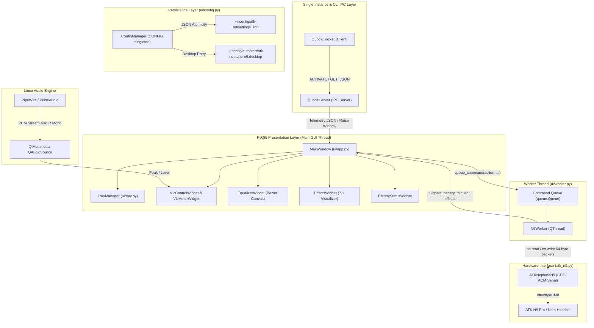

# ATK Neptune N9 Linux Architecture & Design Patterns

This document explains the software architecture, threading model, IPC mechanism, and state management for AI agents extending or debugging this repository.

---

## 1. System Architecture Diagram

---

## 2. Concurrency & Threading Model

### 2.1 The Main GUI Thread
- Runs the `QApplication` event loop.
- Renders all PyQt6 widgets, animations, and charts.
- Hosts the `QLocalServer` IPC instance for single-instance enforcement and CLI queries.
- **Never blocks on serial I/O or sleep calls.**

### 2.2 The Background Worker Thread (`N9Worker`)
- Inherits from `QThread`.
- Handles all blocking serial operations (`open`, `tcflush`, `read`, `write`, `select`).
- Periodically polls RF status and battery level (`poll_interval = 1.5s`).
- Consumes incoming commands from `self._cmd_queue` (`queue.Queue`) safely populated by the UI.
- Reads spontaneous/asynchronous telemetry events from the headset.
- Uses **interruptible sleep** (`_interruptible_sleep`) so thread shutdown responds in under 50ms upon application exit.

### 2.3 Signal-Slot Boundary
All data passing between `N9Worker` and `MainWindow` uses Qt's thread-safe queued signals:
- `sig_connection_changed(bool, str)`: Port open state and port path.
- `sig_status_updated(dict)`: RF link state, battery level, charging flag.
- `sig_mic_updated(dict)`: Mute, mic volume, sidetone enable, sidetone volume.
- `sig_eq_updated(dict)`: Active preset ID, 10-band array.
- `sig_surround_updated(dict)`: 7.1 virtual spatializer state.
- `sig_effect_updated(dict)`: Voice changer effect ID and name.

---

## 3. Single-Instance & IPC Protocol

The entry point [main.py](../main.py) uses a local Unix domain socket (`SOCKET_NAME = "atk_neptune_n9_single_instance_socket"`):

1. **New Process Startup:**
   - Instantiates `SingleInstanceApp`.
   - Checks if a server is listening via `QLocalSocket.connectToServer()`.
2. **If Primary Instance Exists:**
   - If `--json` flag was passed: sends `GET_JSON\n`, receives live JSON payload, prints to stdout, and exits with code 0.
   - If normal launch: sends `ACTIVATE\n` (which causes primary to call `window.show_and_activate()`), prints message, and exits with code 0.
   - If `--minimized` was passed: silently exits with code 0.
3. **If Primary Instance Does Not Exist:**
   - Becomes the primary server.
   - Removes any stale socket file left from abrupt crash via `QLocalServer.removeServer()`.
   - Starts listening on the socket.
   - Registers `aboutToQuit` signal to clean up server and remove socket file on exit.

---

## 4. Window Lifecycle & Tray Management

### 4.1 Hide vs. Quit Rules
- `app.setQuitOnLastWindowClosed(False)` is deliberately configured in `main.py` so that hiding the window to the system tray does not terminate the Qt event loop.
- To prevent orphan background processes, [ui/app.py](../ui/app.py) manages closing explicitly via `self._is_quitting` flag:
  - **When `minimize_to_tray == True` and window close (X) is clicked:**
    `closeEvent` calls `event.ignore()` and `self.hide()`. The worker and tray remain running.
  - **When `minimize_to_tray == False` and window close (X) is clicked:**
    `_is_quitting` is set to `True`, `tray_manager.cleanup()` is called, `worker.stop()` terminates the thread, `event.accept()` closes the window, and `QApplication.quit()` cleanly terminates the process.
  - **When tray "Quit" (Çıkış) is clicked:**
    `_quit_application()` sets `_is_quitting = True`, stops worker, cleans up tray, and triggers `QApplication.quit()`.

---

## 5. Configuration & Persistence

Managed by [ui/config.py](../ui/config.py):
- **Directory Path:** `$XDG_CONFIG_HOME/atk-n9` or `~/.config/atk-n9`.
- **Symlink Alias:** `~/.config/atk-neptune-n9` automatically links to `atk-n9` for user convenience.
- **Atomic File Write:** Writes to `settings.json.tmp` first, then atomically replaces `settings.json` to prevent file corruption during sudden power-off.
- **Autostart:** Generates or unlinks `~/.config/autostart/atk-neptune-n9.desktop`.

---

## 6. Live VU Meter Architecture

Located in [ui/components/vu_meter.py](../ui/components/vu_meter.py):
- Uses `PyQt6.QtMultimedia.QAudioSource` and `QMediaDevices`.
- Detects the ATK N9 recording source (`"ATK N9 PRO dongle Mono"`).
- Runs a 40ms timer (`~25 FPS`) reading 16-bit PCM samples and calculating peak amplitude.
- Features smooth decay and peak hold rendering.
- **Lazy Execution:** To conserve system resources, `MainWindow` monitors `pages_stack.currentChanged`. The audio source only captures when the user has the **Microphone** tab visible; it immediately sleeps when navigating to any other tab or minimizing to the tray.
