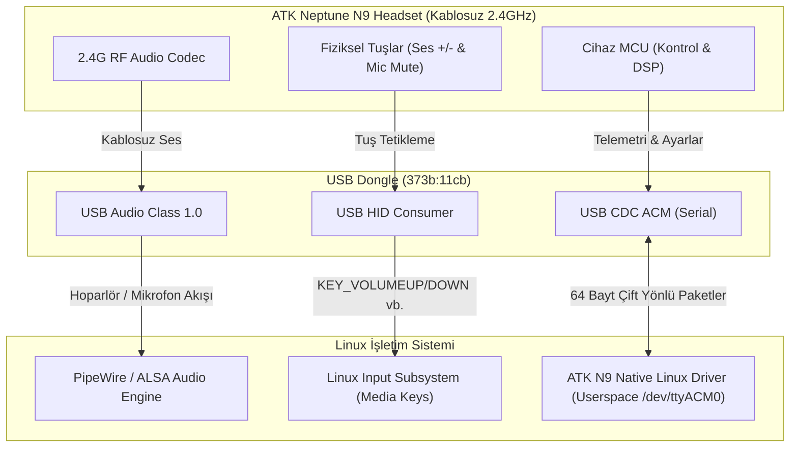

# ATK Neptune N9 (Pro / Ultra) - Linux Protokol Analizi ve Donanım İletişim Raporu

Bu belge, **ATK Neptune N9 Pro / Ultra** kablosuz oyuncu kulaklığının Linux üzerinde yerel (native) bir sürücüsünü geliştirmek amacıyla yapılan tersine mühendislik, USB veri akışı analizi ve canlı donanım test sonuçlarını içermektedir.

Kulaklık **2.4 GHz USB Dongle modunda** bağlıyken testler yapılmış ve tüm kontrol/veri kanalları doğrulanmıştır.

---

## 1. Donanım ve USB Arayüz Mimarisi (Hardware Topology)

Kulaklık dongle veya kablo ile bilgisayara bağlandığında tek bir USB Composite Device olarak görünür. Sistemdeki USB tanımlayıcıları şöyledir:

| Model | Mod | USB VID:PID | Üretici ve Cihaz Adı |
| :--- | :--- | :--- | :--- |
| **N9 Pro** | 2.4 GHz Dongle | `373b:11cb` | Beibinghe Technology ATK N9 PRO dongle |
| **N9 Pro** | Kablolu (Type-C) | `373b:11ca` | Beibinghe Technology ATK N9 PRO |
| **N9 Ultra** | 2.4 GHz Dongle | `373b:1204` | Beibinghe Technology ATK N9 Ultra dongle |
| **N9 Ultra** | Kablolu (Type-C) | `373b:1203` | Beibinghe Technology ATK N9 Ultra |

### USB Arayüzleri (Interfaces) ve Görev Dağılımı

Dongle takıldığında Linux çekirdeği cihazı 7 ayrı USB arayüzüne ayırır:

```
[ATK N9 Composite USB Device - 373b:11cb]
 ├── Interface 0: AudioControl (UAC 1.0)
 ├── Interface 1: AudioStreaming (Hoparlör / Çıkış - Stereo 16/24bit 48kHz)
 ├── Interface 2: AudioStreaming (Mikrofon / Giriş - Mono 16bit 48kHz)
 ├── Interface 3: Custom Vendor HID (Usage Page: 0xFF02, 64-byte In/Out) -> /dev/hidraw3
 ├── Interface 4: Consumer Control HID (Usage Page: 0x000C, Usage: 0x01) -> /dev/hidraw5 (Medya Tuşları)
 ├── Interface 5: CDC ACM Communication Control -> /dev/ttyACM0
 └── Interface 6: CDC ACM Data (Bulk In/Out 64-byte) -> /dev/ttyACM0
```

1. **Arayüz 0, 1, 2 (USB Audio Class 1.0):**
   - Kulaklığın ses çıkışı ve mikrofon girişidir.
   - Linux çekirdeğindeki `snd-usb-audio` modülü tarafından otomatik olarak tanınır ve **PipeWire / ALSA** tarafından doğrudan yönetilir.
   - Herhangi bir özel çekirdek sürücüsü gerektirmez.

2. **Arayüz 4 (HID Consumer Control - `/dev/hidraw5`):**
   - Kulaklık üzerindeki fiziksel tuşları (Ses Artırma `0x00E9`, Ses Azaltma `0x00EA`, Sessize Alma `0x00E2`, Oynat/Duraklat `0x00CD` vb.) iletir.
   - Standart Linux `hid-generic` sürücüsü bu tuşları doğrudan masaüstü ortamına (`KEY_VOLUMEUP`, `KEY_VOLUMEDOWN`, `KEY_MUTE`) çevirir.

3. **Arayüz 5 ve 6 (USB CDC ACM - Seri Haberleşme Portu `/dev/ttyACM0`):**
   - **Kulaklığın asıl yönetim, telemetri, ayar ve kontrol merkezidir.**
   - Batarya durumu, kablosuz bağlantı durumu, mikrofon yan ton (sidetone / monitor), 10 bantlı donanımsal ekolayzır (EQ), sanal 7.1 çevresel ses ve ses değiştirici efektler tamamen bu port üzerinden iletilir.

---

## 2. Kulaklıktan Bilgisayara Giden Verilerin Akış Mekanizması

Veri akışı üç ayrı düzlemde gerçekleşir:



### 1. Ses Akışı (Audio Stream):
- **Hoparlör:** Bilgisayardan kulaklığa PipeWire üzerinden PCM 48kHz Stereo gider.
- **Mikrofon:** Kulaklıktan bilgisayara PipeWire üzerinden PCM 48kHz Mono gelir.

### 2. Donanım Tuşları Akışı (Hardware Keys Stream):
- Fiziksel tuşa basıldığında dongle, Interface 4 üzerinden standart HID Consumer Raporu (2 bayt) üretir. Masaüstü ortamı kulaklığın ses çarkını anında algılar.

### 3. Yönetim ve Telemetri Akışı (Control & Telemetry Stream):
- `/dev/ttyACM0` üzerinden **9600 Baud, 8N1** konfigürasyonunda çift yönlü paketler akar.
- **Sorgu - Yanıt (Poll / Command):** Bilgisayar bir sorgu paketi gönderdiğinde kulaklık mikrokontrolcüsü (MCU) aynı formatta bir yanıt döndürür.
- **Spontane Olaylar (Async Push Events):** Kulaklığın mikrofonu katlandığında/açıldığında, mute tuşuna basıldığında veya şarj/batarya seviyesi değiştiğinde kulaklık bilgisayara sormadan doğrudan seri porta olay paketi basar.

---

## 3. Seri Haberleşme Protokolü Detayları (CDC ACM Protocol)

### Seri Port Konfigürasyonu
- **Baud Rate:** `9600`
- **Data Bits:** `8`
- **Stop Bits:** `1`
- **Parity:** `None`
- **Flow Control:** `None (donanımsal veya yazılımsal akış kontrolü yok)`

### Paket Yapısı (64 Bayt Sabit Uzunluk)
Tüm giden (Host -> Device) ve gelen (Device -> Host) paketler **tam olarak 64 bayttır**. Paket boyutu 64 bayttan az ise sonu `0x00` ile doldurulur (padding).

```
+------------+------------+---------------+----------------------+------------------------+
| Byte 0     | Byte 1     | Byte 2        | Byte 3 .. (Len)      | Byte (Len+1) .. 63     |
+------------+------------+---------------+----------------------+------------------------+
| Payload    | Ana Komut  | Alt Komut     | Veri Yükü (Data)     | Dolgu (Padding)        |
| Uzunluğu   | (Category) | (Sub-Command) |                      | 0x00                   |
+------------+------------+---------------+----------------------+------------------------+
```

- **Byte 0 (Length):** Paketteki anlamlı bayt sayısı (`Data Length + 2`).
- **Byte 1 (Category / Cmd):** Komut kategorisi.
- **Byte 2 (SubCmd):** İlgili kategorideki spesifik fonksiyon.
- **Byte 3..N:** Parametreler veya okunan değerler.

### Ana Komut Kategorileri (`xr`)
| Değer (Hex) | Değer (Dec) | İsim | Açıklama |
| :--- | :--- | :--- | :--- |
| `0x00` | 0 | **AUTH** | Kimlik, Bağlantı durumu, Batarya seviyesi |
| `0x01` | 1 | **SPEAKER** | Hoparlör ses ayarları |
| `0x02` | 2 | **MICROPHONE** | Mikrofon sesi, Mute durumu, Sidetone (Yan ton) |
| `0x03` | 3 | **EQ** | Donanımsal 10 bant Ekolayzır profilleri ve değerleri |
| `0x04` | 4 | **EFFECT** | Ses değiştirici efektler (Voice Changer) |
| `0x05` | 5 | **SURROUND** | Sanal 7.1 Çevresel Ses açma/kapama |
| `0x80` | 128 | **REPORT** | Raporlama ve telemetri bildirimleri |

---

## 4. Gerçek Donanım Üzerinde Yapılan Testler ve Protokol İncelemesi

Aşağıdaki tüm paketler halihazırda bağlı olan **ATK N9 Pro** kulaklığa `/dev/ttyACM0` üzerinden canlı olarak gönderilmiş ve dönen gerçek baytlar kaydedilmiştir:

### 4.1. Bağlantı Durumu Sorgulama (GetStatus)
Dongle ile kulaklık arasındaki 2.4 GHz kablosuz RF bağlantısının aktif olup olmadığını sorgular.

- **Gönderilen (Tx):**
  ```hex
  02 00 04 00 00 00 ... (64 bayt)
  ```
  *(Len: 2, Cmd: 0x00 [AUTH], SubCmd: 0x04 [GetStatus])*

- **Alınan (Rx):**
  ```hex
  04 00 04 00 01 00 00 ... (64 bayt)
  ```
  - `Byte 0: 0x04` (Uzunluk: 4)
  - `Byte 1: 0x00` (AUTH)
  - `Byte 2: 0x04` (GetStatus)
  - `Byte 3: 0x00` (Ayrılmış)
  - `Byte 4: 0x01` -> **1 = Bağlı (Connected), 0 = Bağlantı Yok (Disconnected)**

---

### 4.2. Batarya Seviyesi ve Şarj Durumu (GetBattery)
Kulaklığın güncel pil yüzdesini ve şarj edilip edilmediğini döndürür.

- **Gönderilen (Tx):**
  ```hex
  02 00 03 00 00 00 ... (64 bayt)
  ```
  *(Len: 2, Cmd: 0x00 [AUTH], SubCmd: 0x03 [GetBattery])*

- **Alınan (Rx):**
  ```hex
  04 00 03 00 5a 00 00 ... (64 bayt)
  ```
  - `Byte 4: 0x5a` (Ondalık: **90**)
  - **Ayrıştırma Kuralı:**
    - Şarj Durumu: `(Byte 4 >> 7) == 1` -> **False (Şarj olmuyor)**
    - Pil Yüzdesi: `Byte 4 & 0x7F` -> `0x5A & 0x7F = 90` -> **%90 Batarya**

---

### 4.3. Mikrofon ve Sidetone (Yan Ton) Ayarları (GetMicrophoneInfo)
Mikrofonun susturulma (mute) durumunu, kazancını ve kulaklığın kendi sesinizi kulaklığa geri vermesini sağlayan donanımsal monitörleme (sidetone) ayarlarını okur.

- **Gönderilen (Tx):**
  ```hex
  04 02 00 01 00 00 ... (64 bayt)
  ```
  *(Len: 4, Cmd: 0x02 [MICROPHONE], SubCmd: 0x00 [GetAll], Param: 0x01)*

- **Alınan (Rx):**
  ```hex
  06 02 00 00 64 01 64 00 00 ... (64 bayt)
  ```
  - `Byte 3: 0x00` -> **Mute: 0 (Mikrofon Açık)** [1 olsaydı Muted]
  - `Byte 4: 0x64` -> **Mikrofon Sesi: 100** (%100)
  - `Byte 5: 0x01` -> **Sidetone Monitör: 1 (Aktif / Açık)**
  - `Byte 6: 0x64` -> **Sidetone Monitör Ses Seviyesi: 100** (%100)

- **Mikrofon & Sidetone Ayarlama (SetMicrophoneInfo):**
  - Komut: `Cmd: 0x02, SubCmd: 0x20 (SetAll)`
  - Veri Yükü: `[Mute (0/1), MicVol (0-100), SidetoneEn (0/1), SidetoneVol (0-100)]`
  - Paket: `06 02 20 <mute> <mic_vol> <sidetone_en> <sidetone_vol> 00...`

---

### 4.4. Donanımsal Ekolayzır (EQ) ve 10 Bant Frekans Kontrolü

ATK Neptune N9, ses işlemesini doğrudan kulaklığın kendi dahili DSP çipi üzerinde 10 bantlı parametrik ekolayzır ile yapar.

#### Ekolayzır Frekans Bantları
Ekolayzırın 10 bandı sırasıyla şunlardır:
1. **32 Hz**
2. **64 Hz**
3. **125 Hz**
4. **250 Hz**
5. **500 Hz**
6. **1 kHz**
7. **2 kHz**
8. **4 kHz**
9. **8 kHz**
10. **16 kHz**

Değerler **-20 dB ile +20 dB** arasında işaretli (signed int8) sayılardır:
- `0 dB` = `0x00`
- `+1 dB` = `0x01`, `+5 dB` = `0x05`, `+20 dB` = `0x14`
- `-1 dB` = `0xFF`, `-5 dB` = `0xFB`, `-20 dB` = `0xEC`

#### Aktif Ekolayzır Profil ID'sini Okuma (GetEqId):
- **Gönderilen (Tx):** `02 03 01 00...` (Cmd: 0x03, SubCmd: 0x01)
- **Alınan (Rx):** `03 03 01 05 00...` -> `Byte 3: 0x05` (**Aktif Profil ID: 5**)

#### Ekolayzır Profil Değerlerini Okuma (GetEqData):
- **Gönderilen (Tx):** `03 03 02 05 00...` (Cmd: 0x03, SubCmd: 0x02, Preset: 5)
- **Alınan (Rx):**
  ```hex
  0c 03 02 00 00 00 00 00 00 00 00 00 00 00 ... (64 bayt)
  ```
  *(10 adet 0 dB frekans bandı)*

#### Ekolayzır Ayarlama Testi (Canlı Olarak Kanıtlandı):
Sürücümüz aracılığıyla `pop` profili (`[1, -1, 1, 0, -1, 0, 1, -2, -1, 0]`) donanıma yazılmış ve geri okunduğunda tam olarak doğrulandığı görülmüştür:
```
32Hz  : +1 dB
64Hz  : -1 dB
125Hz : +1 dB
250Hz : +0 dB
500Hz : -1 dB
1kHz  : +0 dB
2kHz  : +1 dB
4kHz  : -2 dB
8kHz  : -1 dB
16kHz : +0 dB
```
Ardından ayar güvenle tekrar varsayılan `flat` (0 dB) moduna getirilmiştir.

---

### 4.5. Sanal 7.1 Çevresel Ses (Surround 7.1)
- **Sorgu:** `Cmd: 0x05, SubCmd: 0x00`
  - Yanıt: `05 05 00 00 00 00` -> `Byte 3: 0x00` (**Kapalı / Disabled**)
- **Açma/Kapatma:** `Cmd: 0x05, SubCmd: 0x20`, Veri: `[Enable (0/1), 0, 0, 0]`

---

### 4.6. Ses Değiştirici Efektler (Voice Changer Effects)
- **Sorgu:** `Cmd: 0x04, SubCmd: 0x00`
  - Yanıt: `05 04 00 00 00 00` -> `Byte 3: 0x00` (Kapalı), `Byte 4: 0x00` (Efekt ID: 0)
- **Desteklenen Efekt ID'leri:**
  - `0`: Erkek Sesi (Male)
  - `1`: Kadın Sesi (Female)
  - `2`: Canavar Sesi (Monster)
  - `3`: Çizgi Film / Ördek Sesi (Cartoon)
- **Ayarlama:** `Cmd: 0x04, SubCmd: 0x20, Veri: [EffectID]`

---

### 4.7. Kulaklıktan Kendiliğinden Gelen Telemetri Olayları (Async Events)

Kulaklıkta bir fiziksel durum değiştiğinde, kulaklık dongle üzerinden bilgisayara kendiliğinden (unsolicited) 64 baytlık paket gönderir:

| Olay Tipi | SubCmd (Hex / Dec) | Veri Açıklaması |
| :--- | :--- | :--- |
| **Batarya Değişimi** | `0x83` (131) | Pil yüzdesi ve şarj durumu değiştiğinde tetiklenir. |
| **Mikrofon Mute Tuşu** | `0xA1` (161) | Kulaklıktaki mute tuşuna basıldığında veya mikrofon kolu kaldırıldığında (`data[0] == 1` susturuldu, `0` aktif). |
| **Sidetone Toggle** | `0xA3` (163) | Yan ton tuşuna basıldığında (`data[0] == 1` açık, `0` kapalı). |

---

## 5. ATK Hub'da Bulunan Hazır Oyun Ekolayzır Profilleri (Presets)

Tersine mühendislik sırasında ATK'nın resmi yazılımında (`hub.atk.pro`) N9 modeli için bulunan hazır EQ profilleri ve frekans değerleri çıkartılmıştır:

| Profil Adı | Değerler (32Hz -> 16kHz) |
| :--- | :--- |
| **Flat / Close** | `[0, 0, 0, 0, 0, 0, 0, 0, 0, 0]` |
| **Pop** | `[1, -1, 1, 0, -1, 0, 1, -2, -1, 0]` |
| **Counter-Strike 2 (CS2)** | `[-4, -4, -1, 0, 2, 5, 4, 1, 0, -2]` |
| **Valorant 1** | `[-3, -3, -1, 0, 2, 2, 4, 3, 1, 1]` |
| **Valorant 2** | `[-2, -1, 0, 5, -2, 1, 3, 2, -3, -1]` |
| **PUBG 1** | `[-2, -2, -1, -1, 1, 2, 3, 2, 0, -2]` |
| **PUBG 2** | `[-4, -3, -1, 0, 1, 3, 3, 2, 0, -1]` |
| **Apex Legends** | `[-1, 0, 0, -1, 1, 3, 4, 2, 1, 0]` |
| **Overwatch** | `[-2, -2, 0, 1, 2, 3, 4, 2, 0, -1]` |
| **Delta Force** | `[0, 0, 5, 3, 5, 2, 3, 2, 0, -5]` |

---

## 6. Geliştirilen Yerel Linux Sürücüsü ve Kullanımı

Bu proje kapsamında kullanıcı uzayında (userspace) çalışan, harici tarayıcı veya ATK Hub bağımlılığı olmayan bağımsız bir Python sürücüsü (`atk_n9.py`) geliştirilmiştir.

### Geliştirilen Dosyalar:
1. [`atk_n9.py`](file:///home/excalibur/Workspace/projects/atk-linux-driver/atk_n9.py): Cihazı otomatik bulan, paketleri serileştiren/ayrıştıran ve CLI arayüzü sunan ana sürücü kütüphanesi.
2. [`udev/99-atk-n9.rules`](file:///home/excalibur/Workspace/projects/atk-linux-driver/udev/99-atk-n9.rules): Normal kullanıcıların root yetkisi olmadan `/dev/ttyACM*` ve `/dev/hidraw*` aygıtlarına erişebilmesini sağlayan udev kuralı.

### CLI Komutları ile Canlı Kullanım Örnekleri:

#### 1. Kulaklık Durumunu ve Pilini Görme:
```bash
python3 atk_n9.py status
```
*Örnek Çıktı:*
```text
============================================================
             ATK NEPTUNE N9 - DEVICE STATUS
============================================================
Device Port       : /dev/ttyACM0
Wireless Status   : Connected
Battery Level     : 90%
------------------------------------------------------------
Microphone & Sidetone:
  Mute            : ACTIVE
  Mic Volume      : 100%
  Sidetone        : Enabled
  Sidetone Volume : 100%
------------------------------------------------------------
Audio Enhancements:
  Virtual 7.1     : OFF
  Voice Changer   : OFF
------------------------------------------------------------
Equalizer Profile (ID 5):
    32Hz :  +0 dB  |####################
    64Hz :  +0 dB  |####################
   125Hz :  +0 dB  |####################
   250Hz :  +0 dB  |####################
   500Hz :  +0 dB  |####################
    1kHz :  +0 dB  |####################
    2kHz :  +0 dB  |####################
    4kHz :  +0 dB  |####################
    8kHz :  +0 dB  |####################
   16kHz :  +0 dB  |####################
============================================================
```

#### 2. Yan Tonu (Sidetone / Kendi Sesini Duyma) Açma / Kapatma:
```bash
# Sidetone'u %80 ses seviyesinde aç
python3 atk_n9.py sidetone on 80

# Sidetone'u kapat
python3 atk_n9.py sidetone off
```

#### 3. Ekolayzır Önayarı (Preset) Yükleme:
```bash
# Counter-Strike 2 adımları belirginleştiren profil:
python3 atk_n9.py preset cs2

# Valorant profili:
python3 atk_n9.py preset valorant1

# Standart düz profil:
python3 atk_n9.py preset flat
```

---

## 7. Sonuç ve Linux Sürücü Mimarisi Değerlendirmesi

- **Kernel Modülü Gerekli midir?**
  **Hayır.** Kulaklığın ses iletimi zaten standart USB Audio Class (UAC 1.0) olduğundan Linux çekirdeği tarafından kusursuz desteklenmektedir. Medya tuşları da standart HID Consumer Controls olarak kernel tarafından işlenmektedir.
- **En İdeal Mimari:**
  Kulaklığın bataryasını, sidetone'unu ve EQ ayarlarını yönetmek için en temiz, kararlı ve taşınabilir mimari **Userspace Daemon / CLI + D-Bus Servisi**dir.
  - Arka planda çalışan hafif bir servis, `UPower` veya PipeWire ile entegre edilerek masaüstü tepsisinde (GNOME / KDE / Waybar) batarya yüzdesini gösterebilir.
  - Kullanıcı istediğinde ses profilini veya sidetone ayarlarını tek tıkla değiştirebilir.
